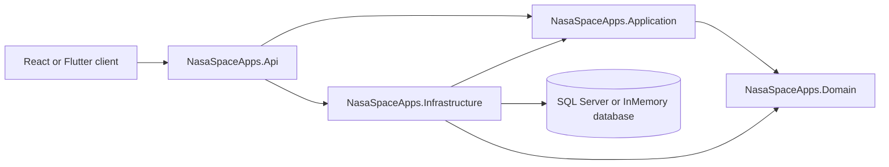

# NASA Space Apps Backend

ASP.NET Core 8 Web API for the NASA Space Apps platform. The backend supports teams, challenges, judging, standings, service requests, attendance, sponsors, and JWT-based team login.

## Technology

- .NET 8
- ASP.NET Core Web API
- Entity Framework Core 8
- SQL Server for remote or persistent data
- EF Core InMemory provider for local development
- JWT bearer authentication
- Serilog console logging
- Swagger/OpenAPI in Development
- xUnit tests

## Solution Structure

```text
NasaSpaceApps.slnx
|
+-- NasaSpaceApps.Api/                    HTTP entry point
|   +-- Controllers/                       REST endpoints
|   +-- Program.cs                         Dependency injection and middleware
|   +-- appsettings.json                   Safe defaults
|   +-- Properties/launchSettings.json     Local launch profiles
|
+-- NasaSpaceApps.Application/             Use cases and business workflows
|   +-- Services/                          Auth, teams, challenges, judging, etc.
|   +-- Interfaces/                        Application ports and contracts
|   +-- Common/Result.cs                    Success/error result type
|
+-- NasaSpaceApps.Domain/                  Core business model
|   +-- Entities/DomainModels.cs            Teams, students, projects, scores, etc.
|
+-- NasaSpaceApps.Infrastructure/          External concerns
|   +-- Data/NasaSpaceAppsDbContext.cs      EF model, schema setup, seed data
|   +-- Repositories/                       Database access implementation
|   +-- Services/                           Password hashing and JWT tokens
|
+-- NasaSpaceApps.Api.Tests/                API test project
+-- NasaSpaceApps.Application.Tests/        Application test project
+-- Docs/                                   ERD, PRD, design contract, decisions
```

## Architecture

The solution is a layered monolith. Dependencies point inward toward the domain and application layers.



### Request flow

1. A client sends an HTTP request to an API controller.
2. The controller validates the request shape and calls an application service.
3. The application service applies business rules and uses `INasaSpaceAppsRepository` where applicable.
4. Infrastructure uses EF Core to read or write the configured database.
5. The controller maps the result to an HTTP response.

### Layer responsibilities

**API**

- Routing and HTTP status codes
- Request and response models
- JWT authentication and authorization middleware
- Swagger configuration
- Dependency injection composition

**Application**

- Use-case services such as `AuthService`, `TeamService`, `ChallengeService`, and `JudgingService`
- Business validation and result handling
- Standings calculation
- Interfaces that keep application logic independent of infrastructure details

**Domain**

- Entities and relationships
- No database or HTTP concerns
- Shared business data types used by the other layers

**Infrastructure**

- `NasaSpaceAppsDbContext` and EF Core mappings
- SQL Server and InMemory provider configuration
- Repository implementation
- BCrypt password hashing
- JWT token generation
- First-run schema creation and development seed data

## Database Configuration

The API chooses its database provider from `ConnectionStrings:DefaultConnection` in the standard ASP.NET Core configuration chain:

- Non-empty connection string: SQL Server
- Empty or missing connection string: EF Core InMemory database named `NasaSpaceApps`

The committed `appsettings.json` intentionally leaves the connection string empty. Do not commit passwords or production JWT keys.

### Use local InMemory storage

Remove the local user secret if one is configured:

```powershell
dotnet user-secrets remove "ConnectionStrings:DefaultConnection" --project NasaSpaceApps.Api
```

### Use a remote SQL Server

Store the connection string in user-secrets:

```powershell
dotnet user-secrets set "ConnectionStrings:DefaultConnection" "Server=HOST;Database=DATABASE;User Id=USER;Password=PASSWORD;Encrypt=True;TrustServerCertificate=True;MultipleActiveResultSets=True;" --project NasaSpaceApps.Api
```

The API calls `EnsureCreated()` during startup. On a new empty SQL Server database, it creates the EF Core schema and inserts development seed data. For production evolution, replace this with reviewed EF Core migrations before deploying schema changes.

## Configuration and Secrets

The API project has a user-secrets ID: `NasaSpaceApps.Api-Local`.

Override the development JWT settings locally:

```powershell
dotnet user-secrets set "Jwt:Key" "replace-with-a-long-random-development-key" --project NasaSpaceApps.Api
dotnet user-secrets set "Jwt:Issuer" "NasaSpaceApps" --project NasaSpaceApps.Api
dotnet user-secrets set "Jwt:Audience" "NasaSpaceApps.Client" --project NasaSpaceApps.Api
```

The fallback JWT key in `appsettings.json` is for local development only. Use a secret manager or environment variables outside local development.

## Run Locally

Prerequisites:

- .NET 8 SDK
- Access to the repository directory
- SQL Server only if using persistent or remote storage

From the repository root:

```powershell
dotnet restore NasaSpaceApps.slnx
dotnet build NasaSpaceApps.slnx
dotnet run --project NasaSpaceApps.Api --urls http://localhost:5050
```

The API is available at:

- API: `http://localhost:5050`
- Swagger UI in Development: `http://localhost:5050/swagger`

## Test

Run all tests:

```powershell
dotnet test NasaSpaceApps.slnx --no-restore
```

Build and test without relying on a previous restore:

```powershell
dotnet build NasaSpaceApps.slnx
dotnet test NasaSpaceApps.slnx
```

Smoke-test the running API:

```powershell
Invoke-WebRequest -Uri "http://localhost:5050/api/v1/challenges" -UseBasicParsing
```

## API Endpoints

All routes use the `/api/v1` prefix.

| Method | Route | Purpose |
|---|---|---|
| `POST` | `/auth/login` | Log in a team and receive a JWT |
| `GET` | `/teams` | Search or list teams |
| `GET` | `/teams/{teamId}` | Get one team |
| `GET` | `/teams/{teamId}/students` | Get team members |
| `GET` | `/challenges` | List challenges |
| `GET` | `/challenges/{challengeId}` | Get one challenge |
| `GET` | `/attendance` | List attendance records |
| `POST` | `/attendance` | Record attendance |
| `GET` | `/requests` | Filter service requests |
| `POST` | `/requests` | Create a service request |
| `GET` | `/judging/criteria` | List judging criteria |
| `POST` | `/judging/scores` | Submit judge scores |
| `GET` | `/standings` | Calculate team standings |
| `GET` | `/sponsors` | List active sponsors |

Example login using the development seed data:

```powershell
$body = @{ username = "orion"; password = "Password123!" } | ConvertTo-Json
Invoke-RestMethod -Method Post -Uri "http://localhost:5050/api/v1/auth/login" -ContentType "application/json" -Body $body
```

## Seed Data

On an empty database, startup creates sample records including:

- Mars Habitat Challenge
- Teams `orion` and `atlas`
- Sample students and projects
- A judge and judging criteria
- Sample scores
- A sponsor and sponsor tier

Change or remove these credentials before using a shared or production database.

## Error Handling

Application services return a common result shape. Controllers convert failures into an HTTP response such as:

```json
{
  "code": "TEAM_NOT_FOUND",
  "message": "Team was not found."
}
```

The exact error code depends on the service operation.

## Development Notes

- Build output is excluded by `.gitignore`; do not commit `bin/` or `obj/`.
- Connection strings and JWT secrets belong in user-secrets, environment variables, or a deployment secret manager.
- The current repository uses `EnsureCreated()` for initial setup rather than migrations.
- Some authorization policies, audit logging, real-time SignalR events, and broader validation described in the design documents remain future work.
- The `Docs/` directory contains the ERD, PRD, design contract, implementation plan, and project decisions.
