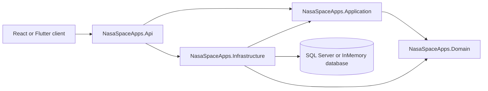

# NASA Space Apps Backend

ASP.NET Core 8 Web API for the NASA Space Apps platform. The backend supports teams, challenges, judging, standings, service requests, attendance, sponsors, and JWT-based team login.

## Technology

- .NET 8
- ASP.NET Core Web API
- Entity Framework Core 8
- SQL Server for remote or persistent data
- EF Core InMemory provider for local development
- JWT bearer authentication
- Serilog console logging
- Swagger/OpenAPI in Development
- xUnit tests

## Solution Structure

```text
NasaSpaceApps.slnx
|
+-- NasaSpaceApps.Api/                    HTTP entry point
|   +-- Controllers/                       REST endpoints
|   +-- Program.cs                         Dependency injection and middleware
|   +-- appsettings.json                   Safe defaults
|   +-- Properties/launchSettings.json     Local launch profiles
|
+-- NasaSpaceApps.Application/             Use cases and business workflows
|   +-- Services/                          Auth, teams, challenges, judging, etc.
|   +-- Interfaces/                        Application ports and contracts
|   +-- Common/Result.cs                    Success/error result type
|
+-- NasaSpaceApps.Domain/                  Core business model
|   +-- Entities/DomainModels.cs            Teams, students, projects, scores, etc.
|
+-- NasaSpaceApps.Infrastructure/          External concerns
|   +-- Data/NasaSpaceAppsDbContext.cs      EF model, schema setup, seed data
|   +-- Repositories/                       Database access implementation
|   +-- Services/                           Password hashing and JWT tokens
|
+-- NasaSpaceApps.Api.Tests/                API test project
+-- NasaSpaceApps.Application.Tests/        Application test project
+-- Docs/                                   ERD, PRD, design contract, decisions
```

## Architecture

The solution is a layered monolith. Dependencies point inward toward the domain and application layers.



### Request flow

1. A client sends an HTTP request to an API controller.
2. The controller validates the request shape and calls an application service.
3. The application service applies business rules and uses `INasaSpaceAppsRepository` where applicable.
4. Infrastructure uses EF Core to read or write the configured database.
5. The controller maps the result to an HTTP response.

### Layer responsibilities

**API**

- Routing and HTTP status codes
- Request and response models
- JWT authentication and authorization middleware
- Swagger configuration
- Dependency injection composition

**Application**

- Use-case services such as `AuthService`, `TeamService`, `ChallengeService`, and `JudgingService`
- Business validation and result handling
- Standings calculation
- Interfaces that keep application logic independent of infrastructure details

**Domain**

- Entities and relationships
- No database or HTTP concerns
- Shared business data types used by the other layers

**Infrastructure**

- `NasaSpaceAppsDbContext` and EF Core mappings
- SQL Server and InMemory provider configuration
- Repository implementation
- BCrypt password hashing
- JWT token generation
- First-run schema creation and development seed data

## Database Configuration

The API chooses its database provider from `ConnectionStrings:DefaultConnection` in the standard ASP.NET Core configuration chain:

- Non-empty connection string: SQL Server
- Empty or missing connection string: EF Core InMemory database named `NasaSpaceApps`

The committed `appsettings.json` intentionally leaves the connection string empty. Do not commit passwords or production JWT keys.

### Use local InMemory storage

Remove the local user secret if one is configured:

```powershell
dotnet user-secrets remove "ConnectionStrings:DefaultConnection" --project NasaSpaceApps.Api
```

### Use a remote SQL Server

Store the connection string in user-secrets:

```powershell
dotnet user-secrets set "ConnectionStrings:DefaultConnection" "Server=HOST;Database=DATABASE;User Id=USER;Password=PASSWORD;Encrypt=True;TrustServerCertificate=True;MultipleActiveResultSets=True;" --project NasaSpaceApps.Api
```

The API calls `EnsureCreated()` during startup. On a new empty SQL Server database, it creates the EF Core schema and inserts development seed data. For production evolution, replace this with reviewed EF Core migrations before deploying schema changes.

## Configuration and Secrets

The API project has a user-secrets ID: `NasaSpaceApps.Api-Local`.

Override the development JWT settings locally:

```powershell
dotnet user-secrets set "Jwt:Key" "replace-with-a-long-random-development-key" --project NasaSpaceApps.Api
dotnet user-secrets set "Jwt:Issuer" "NasaSpaceApps" --project NasaSpaceApps.Api
dotnet user-secrets set "Jwt:Audience" "NasaSpaceApps.Client" --project NasaSpaceApps.Api
```

The fallback JWT key in `appsettings.json` is for local development only. Use a secret manager or environment variables outside local development.

## Run Locally

Prerequisites:

- .NET 8 SDK
- Access to the repository directory
- SQL Server only if using persistent or remote storage

From the repository root:

```powershell
dotnet restore NasaSpaceApps.slnx
dotnet build NasaSpaceApps.slnx
dotnet run --project NasaSpaceApps.Api --urls http://localhost:5050
```

The API is available at:

- API: `http://localhost:5050`
- Swagger UI in Development: `http://localhost:5050/swagger`

## Test

Run all tests:

```powershell
dotnet test NasaSpaceApps.slnx --no-restore
```

Build and test without relying on a previous restore:

```powershell
dotnet build NasaSpaceApps.slnx
dotnet test NasaSpaceApps.slnx
```

Smoke-test the running API:

```powershell
Invoke-WebRequest -Uri "http://localhost:5050/api/v1/challenges" -UseBasicParsing
```

## API Endpoints

All routes use the `/api/v1` prefix. The full request/response contract for the
frontend and mobile teams lives in [`Docs/API_CONTRACT.md`](Docs/API_CONTRACT.md).

| Method | Route | Purpose |
|---|---|---|
| `POST` | `/auth/login/staff` | Staff login (`identifier` + `password`) and receive a JWT |
| `POST` | `/auth/login/participant` | Participant login (`username` + `password`) and receive a JWT plus team/challenge details |
| `GET` | `/auth/me` | Current authenticated account |
| `GET` | `/teams` | Search or list teams |
| `GET` | `/teams/{teamId}` | Get one team (public; includes challenge, project, student names) |
| `GET` | `/teams/{teamId}/students` | Get team members |
| `PATCH` | `/teams/{teamId}/logo` | Set team logo (Admin, base64 ≤ 20 MB) |
| `GET` | `/challenges` | List challenges |
| `GET` | `/challenges/{challengeId}` | Get one challenge |
| `PATCH` | `/challenges/{challengeId}/image` | Set challenge image (Admin, base64 ≤ 20 MB) |
| `GET` | `/attendance` | List attendance records |
| `POST` | `/attendance` | Record attendance |
| `GET` | `/requests` | Filter service requests |
| `POST` | `/requests` | Create a service request |
| `GET` | `/judging/criteria` | List judging criteria + article questions (filter by `challengeId`) |
| `POST` | `/judging/criteria` | Create a criterion (Admin) |
| `POST` | `/judging/criteria/{id}/publish` | Publish own scores (Judge) or force-publish (Admin) |
| `POST` | `/judging/criteria/{id}/unpublish` | Withdraw published scores (Judge/Admin) |
| `GET` | `/judging/standings` | Public scoreboard (averaged across published judges) |
| `POST` | `/judging/scores` | Submit per-question judge scores (upsert) |
| `GET` | `/judging/scores?teamId=` | Per-question score detail (Staff) |
| `GET` | `/sponsors` | List active sponsors |
| `GET` | `/seasonmedia` | List season media (public) |
| `POST` | `/seasonmedia` | Create season media (Admin, base64 ≤ 20 MB) |

Example participant login using the development seed data:

```powershell
$body = @{ username = "orion"; password = "Password123!" } | ConvertTo-Json
Invoke-RestMethod -Method Post -Uri "http://localhost:5050/api/v1/auth/login/participant" -ContentType "application/json" -Body $body
```

## Roles and Permissions

Authorization is a policy check against the JWT `role` claim. Every request carries the token in the standard `Authorization: Bearer <accessToken>` header. The Swagger **Authorize** button attaches it to all operations.

### Roles

| Role | Meaning |
|---|---|
| `Admin` | Full staff access, including staff management, sponsors, and questions |
| `CoreTeam` | Organizers/mentors/developers/media; runs attendance and day-to-day operations |
| `Judge` | Scores teams against the judging criteria's article questions; publishes their own scores to the board |
| `Participant` | A team; submits answers and service requests for its own team only |

`CoreTeam` members also carry a `memberType` (`Organizer`, `Mentor`, `Developer`, `Marketing`, `PR`, `Media`, `Highboard`). This is descriptive metadata only and does **not** grant distinct permissions.

### Policies

Defined in `Program.cs`:

| Policy | Grants access to |
|---|---|
| `AdminOnly` | `Admin` |
| `CoreTeamOnly` | `CoreTeam` |
| `JudgeOnly` | `Judge` |
| `StaffOnly` | `Admin` or `CoreTeam` or `Judge` |
| `ParticipantOnly` | `Participant` |

### Access by endpoint

Public (no token, or `[AllowAnonymous]`):

- `POST /api/v1/auth/login/staff`, `POST /api/v1/auth/login/participant`
- `GET /api/v1/challenges`, `GET /api/v1/challenges/{id}`
- `GET /api/v1/teams`, `GET /api/v1/teams/{id}` (the `username` field is hidden unless the caller is staff)
- `GET /api/v1/sponsors`, `/sponsors/{id}`, `/sponsors/tiers`, `/sponsors/tiers/{id}`
- `GET /api/v1/seasonmedia`, `/seasonmedia/{id}`
- `GET /api/v1/judging/criteria`, `GET /api/v1/judging/standings`
- `GET /api/v1/game/leaderboard`
- SignalR hub `/hubs/judging`

Any authenticated role:

- `GET /api/v1/auth/me`
- `GET /api/v1/requests` (participants are forced to their own team; staff may filter by any team)
- `POST /api/v1/requests` (participants use their own team; staff may post for any team)
- `DELETE /api/v1/requests/{id}` (participants are limited to their own team)
- `GET /api/v1/questions`, `GET /api/v1/questions/{id}` (staff receive correct answers; participants see published questions with answers stripped)
- SignalR hub `/hubs/requests` (joining the `Organizers` group requires staff)

`StaffOnly` — `Admin`, `CoreTeam`, `Judge`:

- `GET /api/v1/teams/{id}/students`
- `PATCH /api/v1/requests/{id}` (resolve)
- `GET /api/v1/judging/scores`
- `GET /api/v1/attendance`

`AdminOnly` — `Admin`:

- All of `/api/v1/staff` (including `/staff/member-types`)
- `POST`, `PUT`, `DELETE` on `/api/v1/sponsors` and `/api/v1/sponsors/tiers`
- `POST`, `PUT`, `DELETE` on `/api/v1/questions`, plus `/questions/{id}/publish` and `/questions/{id}/unpublish`
- `POST`, `PUT`, `DELETE` on `/api/v1/judging/criteria`
- `PATCH /api/v1/teams/{id}/logo`, `PATCH /api/v1/challenges/{id}/image`
- `POST`, `PUT`, `DELETE` on `/api/v1/seasonmedia`

`CoreTeamOnly` — `CoreTeam`:

- `GET /api/v1/attendance/teams` (check-in screen)
- `POST /api/v1/attendance` (bulk upsert)

`JudgeOnly` — `Judge`:

- `POST /api/v1/judging/scores` (the `judgeId` comes from the token, never the body)

`JudgeOrAdminOnly`:

- `POST /api/v1/judging/criteria/{id}/publish` and `.../unpublish` (judge publishes own; admin may force-publish or target a judge)

`ParticipantOnly` — `Participant`:

- `POST /api/v1/game/questions/{questionId}/answer`

### Capability summary

| Capability | Admin | CoreTeam | Judge | Participant |
|---|:---:|:---:|:---:|:---:|
| Browse challenges, teams, sponsors, public standings | Yes | Yes | Yes | Yes |
| Read public leaderboard | Yes | Yes | Yes | Yes |
| View team details and rosters | Yes | Yes | Yes | No |
| View questions with correct answers | Yes | Yes | Yes | No |
| Create / delete own team service requests | Yes | Yes | Yes | Own team only |
| Resolve service requests | Yes | Yes | Yes | No |
| Take attendance (check-in screen) | No | Yes | No | No |
| List attendance records | Yes | Yes | Yes | No |
| Submit judge scores (per question) | No | No | Yes | No |
| List judging criteria | Yes | Yes | Yes | Yes |
| Manage judging criteria | Yes | No | No | No |
| Publish / unpublish own scores | No | No | Yes | No |
| Publish / unpublish any judge's scores (force) | Yes | No | No | No |
| Submit a side-trophy answer | No | No | No | Yes |
| Manage staff, sponsors, questions | Yes | No | No | No |

### Real-time hubs

| Hub | Access | Purpose |
|---|---|---|
| `/hubs/judging` | Anonymous | Live score submissions and standings updates |
| `/hubs/requests` | Authenticated | Request create/update/delete events; the `Organizers` group requires staff |

### Notes and known gaps

- `CoreTeam` members' `memberType` does not affect authorization.
- `GET /api/v1/judging/criteria` and `GET /api/v1/judging/standings` are public; criterion CRUD and per-question score detail require a role. Judges publish their own scores; only Admins may force-publish or target another judge. Scores are averaged across published judges.
- `GET /api/v1/teams/{id}` is public but hides the team `username` from non-staff callers.
- `Admin` cannot access the attendance check-in screen (`/attendance/teams`, `POST /attendance`), which is restricted to `CoreTeam`.
- `Judge` currently shares the full `StaffOnly` surface (requests, rosters, attendance) in addition to scoring.
- Deactivating a staff member blocks new logins but does not revoke already-issued tokens; a token issued with `rememberMe` stays valid for up to 30 days.

## Seed Data

On an empty database, startup creates sample records including:

- Mars Habitat Challenge
- Teams `orion` and `atlas`
- Sample students and projects
- A judge and three challenge-scoped judging criteria (Team Work, Challenge Relevance, Technologies Used) with article questions
- Sample per-question scores published by the seeded judge
- A sponsor and sponsor tier

Change or remove these credentials before using a shared or production database.

## Error Handling

Application services return a common result shape. Controllers convert failures into an HTTP response such as:

```json
{
  "code": "TEAM_NOT_FOUND",
  "message": "Team was not found."
}
```

The exact error code depends on the service operation.

## Development Notes

- Build output is excluded by `.gitignore`; do not commit `bin/` or `obj/`.
- Connection strings and JWT secrets belong in user-secrets, environment variables, or a deployment secret manager.
- Schema is provisioned by idempotent SQL in `DbInitializer` (InMemory uses `EnsureCreated()`); do not call `EnsureCreated()`/`EnsureDeleted()` against SQL Server.
- Some audit logging, real-time SignalR events, and broader validation described in the design documents remain future work.
- The `Docs/` directory contains the ERD, PRD, design contract, implementation plan, project decisions, and the [judging process guide](Docs/JUDGING_PROCESS.md).
